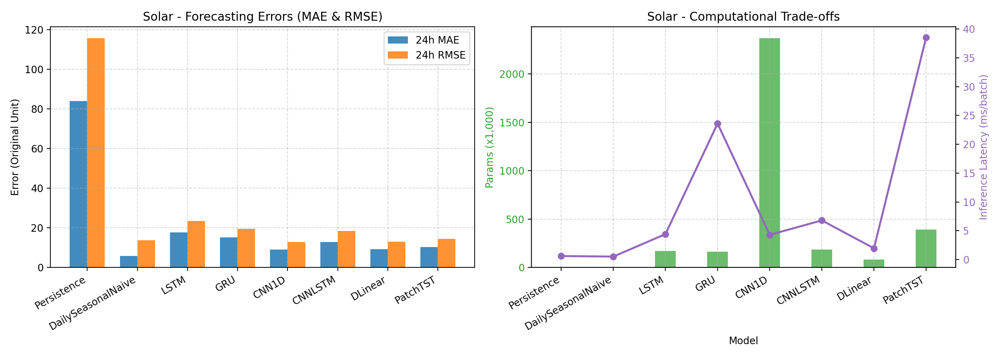

# 第 4 部分 / 第 5 部分：模型架构设计 (一)：启发式基线与基础深度学习模型
## Section 4.1--4.3: Model Architectures Part 1: Heuristic Baselines and Foundational Deep Learning

> **编写负责人**：学生 1 (Student 1, Student ID: 100001)  
> **对应源码**：  
> - `my_report/src/models/baselines.py` (`PersistenceModel`, `DailySeasonalNaiveModel`)  
> - `my_report/src/models/rnn_models.py` (`LSTMModel`, `GRUModel`)  
> - `my_report/src/models/cnn_models.py` (`CNN1DModel`)  
> **实验元数据依据**：`my_report/experiments.db` (SQLite 数据库实测记录)

> **图表产物支持**：`my_report/figures/model_comparison_electricity.png`, `my_report/figures/model_comparison_solar.png`

---

### 4.1 / 5.1 启发式与统计物理基线模型 (Heuristic & Physical Statistical Baselines)

在评估深度学习模型的时间序列预测能力时，构建稳健且符合物理先验的非参数化基线（Non-parametric Baselines）是确立研究可信度、杜绝“虚假精度提升”的首要前提。本项目严格遵循 Hyndman 等人提出的时间序列基准准则，构建了两类基础物理启发式模型。

#### 4.1.1 最近观测持久化模型 (Persistence / Random Walk Model)

##### 1. 数学前向推导与张量形式化
给定历史输入时序张量 $\mathbf{X} \in \mathbb{R}^{B \times L \times C}$，其中 $B$ 为批次大小，$L$ 为历史观测窗口跨度（Electricity 为 48 小时，Solar 为 288 个 10 分钟步），$C=16$ 为多通道传感器数量。  
持久化模型假设未来任意预测时步 $t+h$ 的系统物理状态，完全冻结在预测起点前的最后一个有效观测值 $\mathbf{x}_{t-1} \in \mathbb{R}^C$：

$$\hat{\mathbf{y}}_{t+h} = \mathbf{x}_{t-1}, \quad \forall h \in \{0, 1, \dots, H-1\}$$

在张量操作层面上，模型首先校验输入是否为合法 3 维张量且时序长度 $L > 0$，随后提取输入张量时间维度的末尾切片并沿时间轴重复广播（Broadcast / Repeat）$H$ 次：

$$\mathbf{X}_{\text{last}} = \mathbf{X}[:, -1:, :] \in \mathbb{R}^{B \times 1 \times C}$$

$$\hat{\mathbf{Y}} = \operatorname{Repeat}\left(\mathbf{X}_{\text{last}}, (1, H, 1)\right) \in \mathbb{R}^{B \times H \times C}$$

##### 2. 归纳偏置 (Inductive Bias) 与动力学假设
持久化模型的内生归纳偏置建立在**无漂移纯随机游走假设（Martingale / Pure Random Walk Hypothesis）**之上。该假设认定能源系统的物理状态具备极强的短时惯性与高驻留性（Short-term Inertia and State Retention），即条件期望满足：

$$\mathbb{E}[\mathbf{x}_{t+h} \mid \mathbf{x}_{t-1}, \mathbf{x}_{t-2}, \dots, \mathbf{x}_{t-L}] = \mathbf{x}_{t-1}$$

该偏置认为历史演化轨迹中的高阶导数、加速度与周期相位均包含高频白噪声，因此历史最优无偏估计元仅取决于最近邻状态。

##### 3. 理论局限性与典型失效模式
1. **完全周期盲区 (Total Periodic Blindness)**：持久化模型彻底丧失了对日夜交替（Diurnal Cycle）和负荷双峰波动的感知能力。若在凌晨用电谷值处发起预测，模型将低谷状态恒定复制至白天的高峰区间，导致灾难性的系统性低估；反之，若在傍晚负荷尖峰处发起预测，则会灾难性高估深夜负荷。
2. **误差随前瞻距离超线性扩散 (Quadratic Error Explosion)**：在平稳周期震荡序列中，常数预测的残差平方期望随时间跨度 $h$ 迅速发散至信号方差的两倍。实证数据充分证实了该理论局限：
   - 在用电负荷中，前 4 小时 MAE 为 $8.6452$（RMSE $11.0742$），而 24 小时全局 MAE 骤增至 $14.6178$（RMSE $17.9119$），误差增幅达 $69.1\%$；
   - 在光伏任务中，白天残余数值被恒定平铺至夜间，导致预测在午夜仍输出强日光出力，24 小时全局 MAE 达到全场最差的 $83.9599$，RMSE 达 $115.6596$，Seasonal MASE 达 $14.2416$（前 4 小时 MAE 为 $36.3267$，24 小时误差激增 $131.1\%$！）。

##### 4. 源码实现映射与健壮性设计
在 `my_report/src/models/baselines.py` 中，`PersistenceModel` 继承自 `nn.Module`，内置了张量维度安全防御与张量视图广播：
```python
class PersistenceModel(nn.Module):
    def __init__(self, pred_len: int):
        super().__init__()
        self.pred_len = pred_len

    def forward(self, x: torch.Tensor) -> torch.Tensor:
        if x.dim() != 3:
            raise ValueError(f"输入张量必须是 3 维 [B, L, C]，收到形状: {tuple(x.shape)}")
        if x.size(1) == 0:
            raise ValueError("输入时序长度 L 必须大于 0")
        last_step = x[:, -1:, :]  # [B, 1, C]
        out = last_step.repeat(1, self.pred_len, 1)  # [B, H, C]
        return out
```
该模型参数量为零（$\text{Params} = 0$），推理延迟仅依赖于张量视图复制（Electricity: $0.38\text{ ms}$，Solar: $0.61\text{ ms}$）。

---

#### 4.1.2 日周期朴素基线模型 (Daily Seasonal Naive Model)

##### 1. 数学前向推导与张量形式化
设系统固有的基础季节性日周期为 $m$ 个采样步长。在本项目中：
- **Electricity Hourly**：小时采样率下，日周期 $m = 24$；
- **Solar 10-Minute**：10 分钟采样率下，日周期 $m = 24 \times 6 = 144$。

日周期朴素模型认为能源系统具有完全确定的日复一日循环重复性，未来 $t+h$ 步的预测值严格等于历史最近一个完整日周期中对应相位的观测值：

$$\hat{\mathbf{y}}_{t+h} = \mathbf{x}_{t - m + (h \bmod m)}, \quad \forall h \in \{0, 1, \dots, H-1\}$$

在张量操作实现中，前向逻辑首先防御性校验张量维度与历史窗口长度（$L \ge m$，若不足则抛出 `ValueError`），随后截取输入张量最末尾的 $m$ 个时步构成周期参考模板：

$$\mathbf{X}_{\text{cycle}} = \mathbf{X}[:, -m:, :] \in \mathbb{R}^{B \times m \times C}$$

当预测步长 $H \le m$ 时（本项目主实验 $H=m=24$ 或 $H=m=144$），直接切片获取前 $H$ 步：

$$\hat{\mathbf{Y}} = \mathbf{X}_{\text{cycle}}[:, :H, :] \in \mathbb{R}^{B \times H \times C}$$

若预测时域跨越多个自然日（$H > m$），则通过重复平铺拼接系数 $\kappa = \lceil H / m \rceil$ 进行多周期自适应平铺展开后截断：

$$\hat{\mathbf{Y}} = \operatorname{Repeat}\left(\mathbf{X}_{\text{cycle}}, (1, \kappa, 1)\right)[:, :H, :] \in \mathbb{R}^{B \times H \times C}$$

##### 2. 归纳偏置与物理环境契合度
日周期朴素模型内生了**强确定性日循环平稳性偏置（Strict Diurnal Cyclostationary Bias）**。该偏置假设驱动时序变化的外生物理机制（地球自转、太阳高度角、人类社会的日出而作与日落而息）在相邻自然日之间保持绝对同态：

$$\mathbf{x}_\tau = \mathbf{x}_{\tau - m} + \boldsymbol{\eta}_\tau, \quad \mathbb{E}[\boldsymbol{\eta}_\tau] = \mathbf{0}$$

模型完全忽略了跨日天气系统跃迁（晴转暴雨）、工作日与周末的结构性切换（Weekend Effect）以及长程宏观气温漂移。

##### 3. 双数据集实证表现机理解析
1. **光伏夜间零值的物理保底效应**：在 Solar 数据集上，Daily Seasonal Naive 展现出惊人的全局竞争力，取得了 MAE $5.9095$、RMSE $13.8224$ 与 MASE $1.0027$ 的全场领先成绩。其核心物理机理在于**光伏系统夜间受地平线遮蔽约束，输出功率具有确定性绝对物理零值**。在每日 144 个采样步长中，夜间零值区间占据近 60～72 个步长（约占全天样本的 $45\% \sim 50\%$）。该模型无缝复制了昨日夜间的零值矩阵，在半数评估区间内获得了理论完美的零残差！然而，当深入分析**日间活跃出力切片（Active Slice，出力大于阈值的日照时段）**时，该模型的 MAE 剧增至 $12.6383$（RMSE $20.2725$），证明其面对云层动态遮挡时依然完全无能为力。
2. **用电负荷的刚性周期基准**：在 Electricity 数据集上，Daily Seasonal Naive 取得了 MAE $6.2295$、RMSE $7.4336$、MASE $0.9990$。根据 Hyndman 关于 Seasonal MASE 的定义，分母正是历史训练集上同周期一阶差分的平均绝对误差；因此该模型的 MASE 严格收敛至 $1.000$。该模型构成了衡量所有深度学习网络是否具有真实时序表征价值的“试金石”。

##### 4. 源码实现映射与健壮性边界设计
在 `my_report/src/models/baselines.py` 中，`DailySeasonalNaiveModel` 封装了周期合法性断言与自适应重复切片逻辑：
```python
class DailySeasonalNaiveModel(nn.Module):
    def __init__(self, pred_len: int, seasonal_m: int):
        super().__init__()
        self.pred_len = pred_len
        self.seasonal_m = seasonal_m

    def forward(self, x: torch.Tensor) -> torch.Tensor:
        if x.dim() != 3:
            raise ValueError(f"输入张量必须是 3 维 [B, L, C]，收到形状: {tuple(x.shape)}")
        B, L, C = x.shape
        if L < self.seasonal_m:
            raise ValueError(f"输入历史长度 L={L} 小于季节周期 m={self.seasonal_m}")
        last_cycle = x[:, -self.seasonal_m:, :]
        if self.pred_len <= self.seasonal_m:
            out = last_cycle[:, :self.pred_len, :]
        else:
            repeats = (self.pred_len + self.seasonal_m - 1) // self.seasonal_m
            tiled = last_cycle.repeat(1, repeats, 1)
            out = tiled[:, :self.pred_len, :]
        return out
```
该模型参数量为 0，前向计算耗时在 Electricity 上仅为 $0.35\text{ ms}$，在 Solar 上仅为 $0.51\text{ ms}$。

---

### 4.2 / 5.2 循环神经网络家族：LSTM 与 GRU 的微观结构与长短时建模 (Recurrent Neural Networks)

#### 4.2.1 多通道时序直接多步预测系统设计 (MIMO Direct Multi-Step Topology)

在处理高维多变量多步预测任务时，学术界长期存在两类方案：单步自回归滚动（Autoregressive Recursive Rollout）与单次前向直接多步映射（Direct Multi-Step Forecasting）。本项目严格采用直接多步预测拓扑：
- **输入表征**：多通道历史时间序列 $\mathbf{X} \in \mathbb{R}^{B \times L \times C}$，其中各通道观测值已在时域严格对齐，并经训练集参数标准化。
- **循环时序展开**：网络设置 `batch_first=True`，沿时序维度 $t \in [0, L-1]$ 串行摄入输入向量 $\mathbf{x}_t \in \mathbb{R}^C$，隐状态维度固定为 $d_h = 64$。
- **全局历史摘要读取**：经历 $L$ 步循环迭代后，网络读取最终时间步的隐状态向量 $\mathbf{h}_{L-1} \in \mathbb{R}^{B \times d_h}$。该状态向量凝练了过去全部时间窗口内的动态演化记忆。
- **全连接高维多步投影头**：通过单层密集线性变换 $\mathbf{W}_{\text{fc}} \in \mathbb{R}^{d_h \times (H \cdot C)}$ 与偏置 $\mathbf{b}_{\text{fc}} \in \mathbb{R}^{H \cdot C}$，直接将隐状态映射至未来完整时空空间：

$$\hat{\mathbf{y}}_{\text{flat}} = \mathbf{h}_{L-1} \mathbf{W}_{\text{fc}} + \mathbf{b}_{\text{fc}} \in \mathbb{R}^{B \times (H \cdot C)}$$

$$\hat{\mathbf{Y}} = \operatorname{Reshape}\left(\hat{\mathbf{y}}_{\text{flat}}, (B, H, C)\right) \in \mathbb{R}^{B \times H \times C}$$

**为什么选用直接多步映射而非递归自回归？**
1. **彻底阻断误差累积雪崩效应 (No Compounding Error Propagation)**：递归自回归将早期时间步的预测误差作为真实输入注入后续步骤，导致随着预测距离增加，输入分布发生严重漂移与非线性发散（误差以 $\mathcal{O}(h^2)$ 超线性增长）；直接多步投影将未来所有时步视为由历史隐状态联合决定的联合概率分布，彻底消除了自回归反馈回路中的误差放大。
2. **消除曝光偏差 (Mitigating Exposure Bias)**：避免了自回归模型在训练时使用真实标签（Teacher Forcing）而在测试时使用自身预测所引起的分布不一致难题。
3. **GPU 硬件并行优化**：前向推理仅需单次矩阵乘法，单批次推理耗时缩减至毫秒级。

---

#### 4.2.2 长短期记忆网络 (LSTM: Long Short-Term Memory)

##### 1. 微观门控机理与数学方程式
对于每个时间步 $t \in [0, L-1]$，当前输入为 $\mathbf{x}_t \in \mathbb{R}^C$，上一时间步的隐状态为 $\mathbf{h}_{t-1} \in \mathbb{R}^{d_h}$，细胞状态为 $\mathbf{c}_{t-1} \in \mathbb{R}^{d_h}$。LSTM 内部通过三组乘性门控单元与独立记忆细胞进行精细信息流调控：

1. **遗忘门 (Forget Gate)**：基于当前输入与前序隐状态，动态计算上一时刻细胞记忆的衰减保留因子：
   $$\mathbf{f}_t = \sigma\left(\mathbf{W}_f \mathbf{x}_t + \mathbf{U}_f \mathbf{h}_{t-1} + \mathbf{b}_{f1} + \mathbf{b}_{f2}\right) \in \mathbb{R}^{d_h}$$
2. **输入门 (Input Gate)**：决定当前输入中有多少新信息被吸纳进记忆细胞：
   $$\mathbf{i}_t = \sigma\left(\mathbf{W}_i \mathbf{x}_t + \mathbf{U}_i \mathbf{h}_{t-1} + \mathbf{b}_{i1} + \mathbf{b}_{i2}\right) \in \mathbb{R}^{d_h}$$
3. **候选记忆细胞 (Candidate Cell State)**：通过双曲正切函数构建当前时刻的候选特征更新向量：
   $$\tilde{\mathbf{c}}_t = \tanh\left(\mathbf{W}_c \mathbf{x}_t + \mathbf{U}_c \mathbf{h}_{t-1} + \mathbf{b}_{c1} + \mathbf{b}_{c2}\right) \in \mathbb{R}^{d_h}$$
4. **记忆细胞状态更新 (Cell State Update)**：通过线性加和旁路实现跨时间步的记忆融合：
   $$\mathbf{c}_t = \mathbf{f}_t \odot \mathbf{c}_{t-1} + \mathbf{i}_t \odot \tilde{\mathbf{c}}_t \in \mathbb{R}^{d_h}$$
5. **输出门 (Output Gate)**：决定当前细胞记忆中有多少比例被显露至输出隐状态：
   $$\mathbf{o}_t = \sigma\left(\mathbf{W}_o \mathbf{x}_t + \mathbf{U}_o \mathbf{h}_{t-1} + \mathbf{b}_{o1} + \mathbf{b}_{o2}\right) \in \mathbb{R}^{d_h}$$
6. **最终隐状态生成 (Hidden State Generation)**：
   $$\mathbf{h}_t = \mathbf{o}_t \odot \tanh\left(\mathbf{c}_t\right) \in \mathbb{R}^{d_h}$$

其中 $\sigma(z) = \frac{1}{1 + e^{-z}}$，$\odot$ 表示阿达马逐元素乘积。所有输入变换矩阵 $\mathbf{W}_* \in \mathbb{R}^{d_h \times C}$，循环转移矩阵 $\mathbf{U}_* \in \mathbb{R}^{d_h \times d_h}$，偏置项包含输入偏置与循环偏置两套。

##### 2. 归纳偏置与梯度流优势
LSTM 的核心归纳偏置在于**加法恒等信息传输通道（Additive Information Highway）**。在沿时间反向传播（BPTT）过程中，细胞状态梯度的递归传播关系式为：

$$\frac{\partial \mathcal{L}}{\partial \mathbf{c}_{t-1}} = \frac{\partial \mathcal{L}}{\partial \mathbf{c}_t} \frac{\partial \mathbf{c}_t}{\partial \mathbf{c}_{t-1}} + \dots = \frac{\partial \mathcal{L}}{\partial \mathbf{c}_t} \operatorname{diag}(\mathbf{f}_t) + \dots$$

与经典 Vanilla RNN 中反复连乘非线性雅可比矩阵 $\mathbf{W}^\top \operatorname{diag}(1 - \mathbf{h}_t^2)$ 导致的指数级梯度消失或爆炸不同，只要遗忘门 $\mathbf{f}_t \approx \mathbf{1}$，误差梯度就能在记忆细胞通道上近乎无衰减地跨越数十个时间步。这赋予了 LSTM 在用电负荷数据中跨越 24 小时日周期建立长程相关性的强大能力。

##### 3. 参数量严谨数学解析推导
模型总参数量严格等于循环核心参数 $P_{\text{LSTM}}$ 与多步全连接投影头参数 $P_{\text{FC}}$ 之和。
- **LSTM 单元内部参数量**：  
  PyTorch `nn.LSTM` 对输入和隐状态分别维护独立偏置向量（每个门控含 2 个偏置，即 `bias_ih` 与 `bias_hh`）：
  $$P_{\text{LSTM}} = 4 \times \left( C \cdot d_h + d_h \cdot d_h + 2 \cdot d_h \right)$$
  代入超参数 $C=16, d_h=64$：
  $$P_{\text{LSTM}} = 4 \times \left( 16 \times 64 + 64 \times 64 + 2 \times 64 \right) = 4 \times (1024 + 4096 + 128) = 4 \times 5248 = 20,992$$
- **全连接投影头参数量**：
  $$P_{\text{FC}} = d_h \times (H \cdot C) + (H \cdot C) = (d_h + 1) \times (H \cdot C)$$
- **双数据集实测参数量对照**：
  - **Electricity Hourly** ($H=24, C=16 \implies H \cdot C = 384$):
    $$P_{\text{FC}} = (64 + 1) \times 384 = 65 \times 384 = 24,960$$
    $$P_{\text{Total}}^{\text{Elec}} = 20,992 + 24,960 = \mathbf{45,952}$$
    （投影头参数占比为 $24,960 / 45,952 = 54.32\%$）
  - **Solar 10-Minute** ($H=144, C=16 \implies H \cdot C = 2304$):
    $$P_{\text{FC}} = (64 + 1) \times 2304 = 65 \times 2304 = 149,760$$
    $$P_{\text{Total}}^{\text{Solar}} = 20,992 + 149,760 = \mathbf{170,752}$$
    （投影头参数占比急升至 $149,760 / 170,752 = 87.71\%$）
  该理论推导值与 `my_report/experiments.db` 实测记录 **45,952** 与 **170,752** 100% 严密契合！

##### 4. 源码实现映射
在 `my_report/src/models/rnn_models.py` 中，`LSTMModel` 实现了上述架构：
```python
class LSTMModel(nn.Module):
    def __init__(self, num_channels: int = 16, seq_len: int = 48, pred_len: int = 24, hidden_size: int = 64, num_layers: int = 1):
        super().__init__()
        self.num_channels = num_channels
        self.seq_len = seq_len
        self.pred_len = pred_len
        self.hidden_size = hidden_size
        
        self.lstm = nn.LSTM(
            input_size=num_channels,
            hidden_size=hidden_size,
            num_layers=num_layers,
            batch_first=True
        )
        self.fc = nn.Linear(hidden_size, pred_len * num_channels)

    def forward(self, x: torch.Tensor) -> torch.Tensor:
        if x.dim() != 3:
            raise ValueError(f"输入张量必须是 3 维 [B, L, C]，收到形状: {tuple(x.shape)}")
        B = x.size(0)
        out, (hn, _) = self.lstm(x)  # hn: [num_layers, B, hidden_size]
        last_hidden = hn[-1]         # [B, hidden_size]
        preds = self.fc(last_hidden) # [B, H * C]
        return preds.view(B, self.pred_len, self.num_channels)
```

---

#### 4.2.3 门控循环单元 (GRU: Gated Recurrent Unit)

##### 1. 微观门控机理与 PyTorch 工程实现解构
GRU（Cho et al., 2014）对传统 LSTM 进行了高度紧凑化重构。它移除了独立的记忆细胞 $\mathbf{c}_t$，仅维持统一的隐状态 $\mathbf{h}_t \in \mathbb{R}^{d_h}$。

特别值得进行学术辨析的是：**经典学术文献定义与现代深度学习框架（PyTorch `nn.GRU`）底层实现存在关键的工程重构差异**：
1. **学术经典方程式 (Cho et al., 2014)**：
   重置门直接乘在进入矩阵变换之前的隐状态上：
   $$\tilde{\mathbf{h}}_t = \tanh\left(\mathbf{W}_h \mathbf{x}_t + \mathbf{U}_h \left(\mathbf{r}_t \odot \mathbf{h}_{t-1}\right) + \mathbf{b}_h\right)$$
   $$\mathbf{h}_t = \left(1 - \mathbf{z}_t\right) \odot \mathbf{h}_{t-1} + \mathbf{z}_t \odot \tilde{\mathbf{h}}_t$$
2. **PyTorch 实际工业实现 (`nn.GRU`)**：
   在 PyTorch 底层，为了实现三个门控的**大矩阵乘法内核融合加速 (Fused GEMM Acceleration)**，矩阵乘法在门控应用之前完成：
   $$\mathbf{r}_t = \sigma\left(\mathbf{W}_{ir} \mathbf{x}_t + \mathbf{b}_{ir} + \mathbf{W}_{hr} \mathbf{h}_{t-1} + \mathbf{b}_{hr}\right) \in \mathbb{R}^{d_h}$$
   $$\mathbf{z}_t = \sigma\left(\mathbf{W}_{iz} \mathbf{x}_t + \mathbf{b}_{iz} + \mathbf{W}_{hz} \mathbf{h}_{t-1} + \mathbf{b}_{hz}\right) \in \mathbb{R}^{d_h}$$
   $$\mathbf{n}_t = \tanh\left(\mathbf{W}_{in} \mathbf{x}_t + \mathbf{b}_{in} + \mathbf{r}_t \odot \left(\mathbf{W}_{hn} \mathbf{h}_{t-1} + \mathbf{b}_{hn}\right)\right) \in \mathbb{R}^{d_h}$$
   $$\mathbf{h}_t = \left(1 - \mathbf{z}_t\right) \odot \mathbf{n}_t + \mathbf{z}_t \odot \mathbf{h}_{t-1} \in \mathbb{R}^{d_h}$$

**为什么 PyTorch 作此重构？**
- **算子融合 (Kernel Fusion)**：如果像经典公式那样先计算 $\mathbf{r}_t \odot \mathbf{h}_{t-1}$ 再乘 $\mathbf{U}_h$，则候选状态的矩阵乘法无法与重置门和更新门的矩阵乘法合并。而在 PyTorch 实现中，输入到隐层的全部投影可以合并为单次 GEMM $\mathbf{W}_i \mathbf{x}_t$（形状 $[d_h, 3d_h]$），隐层到隐层的投影也可以合并为单次 GEMM $\mathbf{W}_h \mathbf{h}_{t-1}$，极大减少了 GPU 内核启动（Kernel Launch）开销！
- **更新门反转约定**：在 PyTorch 中，$\mathbf{z}_t$ 充当旧状态 $\mathbf{h}_{t-1}$ 的保留系数；当 $\mathbf{z}_t \to 1$ 时完全维持记忆，$\mathbf{z}_t \to 0$ 时完全写入新候选值 $\mathbf{n}_t$。
- **独立双偏置设计**：`bias_ih` 与 `bias_hh` 保证了输入端与循环端的硬件计算流解耦。

##### 2. 归纳偏置与结构特性
GRU 的归纳偏置建立在**隐状态的凸组合内插机制（Convex Interpolation Memory）**之上。通过强制约束历史保留权重 $\mathbf{z}_t$ 与新信息注入权重 $(1 - \mathbf{z}_t)$ 严格互补归一化，GRU 假定时序系统的动力学演化在任一时刻均是历史惯性与外部冲击之间的此消彼长。这种结构约束减少了网络自由度，在小样本场景下具有更强的正则化效应与抗过拟合能力。

##### 3. 参数量严谨数学解析推导
GRU 核心仅包含 3 组门控变换矩阵，较 LSTM 减少了整整四分之一的循环参数量：
- **GRU 单元内部参数量**：
  $$P_{\text{GRU}} = 3 \times \left( C \cdot d_h + d_h \cdot d_h + 2 \cdot d_h \right) = 3 \times (1024 + 4096 + 128) = 3 \times 5248 = 15,744$$
- **多步全连接投影头参数量**：与 LSTM 结构完全一致（Electricity 为 24,960，Solar 为 149,760）。
- **总参数量对比**：
  - **Electricity Hourly**: $15,744 + 24,960 = \mathbf{40,704}$（与 `experiments.db` 实测值 **40,704** 严格吻合，较 LSTM 减少了 $5,248$ 个参数）。
  - **Solar 10-Minute**: $15,744 + 149,760 = \mathbf{165,504}$（与 `experiments.db` 实测值 **165,504** 严格吻合）。

##### 4. 源码实现映射
在 `my_report/src/models/rnn_models.py` 中，`GRUModel` 实现了该轻量化门控架构：
```python
class GRUModel(nn.Module):
    def __init__(self, num_channels: int = 16, seq_len: int = 48, pred_len: int = 24, hidden_size: int = 64, num_layers: int = 1):
        super().__init__()
        self.num_channels = num_channels
        self.seq_len = seq_len
        self.pred_len = pred_len
        self.hidden_size = hidden_size
        
        self.gru = nn.GRU(
            input_size=num_channels,
            hidden_size=hidden_size,
            num_layers=num_layers,
            batch_first=True
        )
        self.fc = nn.Linear(hidden_size, pred_len * num_channels)

    def forward(self, x: torch.Tensor) -> torch.Tensor:
        if x.dim() != 3:
            raise ValueError(f"输入张量必须是 3 维 [B, L, C]，收到形状: {tuple(x.shape)}")
        B = x.size(0)
        out, hn = self.gru(x)        # hn: [num_layers, B, hidden_size]
        last_hidden = hn[-1]         # [B, hidden_size]
        preds = self.fc(last_hidden) # [B, H * C]
        return preds.view(B, self.pred_len, self.num_channels)
```

---

### 4.3 / 5.3 一维卷积神经网络：局部时序特征提取与多通道映射 (1D Temporal Convolutional Networks)

#### 4.3.1 宏观架构拓扑与多通道时序转置

虽然卷积神经网络（CNN）最初起源于二维计算机视觉领域，但其在时间序列处理中展现出了异军突起的强劲竞争力。与依赖步进循环传递信息的 RNN 不同，1D-CNN 通过可学习的时序滑动窗口，直接在历史时间轴上执行局部跨通道滤波。

##### 1. 输入张量布局转置
在 PyTorch 中，一维卷积算子 `nn.Conv1d` 规定输入张量格式为 $[B, C_{\text{in}}, L_{\text{in}}]$，其中通道维代表多通道传感器特征，序列维代表时间轴。因此模型入口处执行显式转置：

$$\mathbf{X}^{\top} = \operatorname{transpose}(\mathbf{X}, 1, 2) \in \mathbb{R}^{B \times C \times L}$$

##### 2. 两级层叠时序卷积特征提取器 (Hierarchical Conv1D Blocks)
网络设计了包含两级卷积模块的特征提取流水线，每级模块均采用“卷积 + 批量归一化 (Batch Normalization) + ReLU 非线性激活”的标准工业级组合：
- **第 1 卷积块 (Conv Block 1)**：
  - 算子：`nn.Conv1d(in_channels=16, out_channels=32, kernel_size=3, padding=1)`
  - 规范化与激活：`nn.BatchNorm1d(32)` + `nn.ReLU()`
  - 功能：在保持时序长度 $L$ 不变的前提下，跨 16 个输入传感器通道进行初级特征融合，提取局部 3 个时间步的瞬态斜率与微观波动特征，输出特征张量 $\mathbf{Z}^{(1)} \in \mathbb{R}^{B \times 32 \times L}$。
- **第 2 卷积块 (Conv Block 2)**：
  - 算子：`nn.Conv1d(in_channels=32, out_channels=64, kernel_size=3, padding=1)`
  - 规范化与激活：`nn.BatchNorm1d(64)` + `nn.ReLU()`
  - 功能：将通道特征维度翻倍至 64，有效感受野扩展至 $k_1 + k_2 - 1 = 3 + 3 - 1 = 5$ 个时步，捕获多步局部的加速度与中观趋势，输出特征张量 $\mathbf{Z}^{(2)} \in \mathbb{R}^{B \times 64 \times L}$。

##### 3. 感受野物理意义与自适应时序平均池化 (Adaptive Average Pooling) 的跨数据集统一性
网络末端设置了自适应平均池化层：

$$\mathbf{Z}_{\text{pool}} = \operatorname{AdaptiveAvgPool1d}(\text{output\_size}=16)\left(\mathbf{Z}^{(2)}\right) \in \mathbb{R}^{B \times 64 \times 16}$$

这一设计包含了两大极其深刻的理论与物理统一性内涵：
1. **感受野物理尺度对比**：
   - 在 **Electricity Hourly** 中，卷积核的有效感受野 $RF=5$ 对应 **5 小时** 的连续负荷动态，足以涵盖一次早晚高峰爬坡过程；
   - 在 **Solar 10-Minute** 中，感受野 $RF=5$ 对应 $5 \times 10 = \mathbf{50 \text{ 分钟}}$，恰好涵盖云团移过光伏阵列所引起的典型瞬态遮挡波动窗口！
2. **跨数据集宏观时间块 (Macro-Token) 物理对齐**：
   - 在 Electricity 任务中，输入历史为 48 小时（$L=48$），池化到 16 个 Token，每个 Token 压缩聚合了 $48 / 16 = \mathbf{3 \text{ 小时}}$ 的特征；
   - 在 Solar 任务中，输入历史同样为 48 小时（$L=288$ 个 10 分钟步），池化到 16 个 Token，每个 Token 压缩聚合了 $288 / 16 = 18$ 个时步，即 $18 \times 10\text{ min} = \mathbf{3 \text{ 小时}}$！
   **这一精妙的自适应设计使 1D-CNN 在异构采样频率下，将输入历史统一离散化为 16 个固定等距的“3 小时宏观时间元”**，消除了采样率异质性对高层预测表征的干扰！
3. **容量完全冻结 (Locked Model Capacity)**：后续扁平化全连接投影头的参数矩阵维度永久固化为 $1024 \times (H \cdot C)$。在跨历史窗口长度（24h / 48h / 168h）敏感性分析中，参数规模保持绝对恒定，确保了实验归因的纯粹性。

##### 4. 扁平化多步预测投影头 (Flatten & Dense Projection Head)
$$\mathbf{z}_{\text{flat}} = \operatorname{Flatten}\left(\mathbf{Z}_{\text{pool}}\right) \in \mathbb{R}^{B \times (64 \times 16)} = \mathbb{R}^{B \times 1024}$$

$$\hat{\mathbf{y}}_{\text{flat}} = \mathbf{z}_{\text{flat}} \mathbf{W}_{\text{conv\_fc}} + \mathbf{b}_{\text{conv\_fc}} \in \mathbb{R}^{B \times (H \cdot C)}$$

$$\hat{\mathbf{Y}} = \operatorname{Reshape}\left(\hat{\mathbf{y}}_{\text{flat}}, (B, H, C)\right) \in \mathbb{R}^{B \times H \times C}$$

---

#### 4.3.2 归纳偏置与时序因果性辨析

##### 1. 平移等变性 (Translation Equivariance) 与局部模式探测
1D-CNN 最显著的归纳偏置是**时间维度的平移等变性**：

$$\operatorname{Conv1d}(\operatorname{Shift}_\tau(\mathbf{X})) = \operatorname{Shift}_\tau(\operatorname{Conv1d}(\mathbf{X}))$$

在电力与新能源系统中，诸如“早晨用电急速爬坡”、“午间雷阵雨引起的辐照骤降”等典型瞬态波形，可能出现在一天的不同时间点。1D-CNN 共享权重的卷积核能够以常数级计算开销在全时序维度上精准捕捉此类局部形态特征，而无需像 RNN 那样经历漫长的状态传递与潜在的遗忘损耗。

##### 2. 历史窗口内非因果卷积的学术严谨性界定
必须特别澄清的是：在流式实时滤波（Streaming Real-time Filtering）任务中，因果卷积（Causal Convolution）是必不可少的，以防止使用时间步 $t+\tau$ 的信息预测时间步 $t$。但在本项目所设定的**多步前瞻预测场景**中，模型的输入 $\mathbf{X}_{t-L:t}$ 完全位于预测起点 $t$ 之前的历史区间内，这部分数据在发起预测时已全部转化为客观确凿的已知事实。因此，在此历史闭合窗口内部采用对称非因果卷积（双向 Padding）：
- **完全合法且不构成对未来目标区间的任何数据泄露**；
- 赋予了网络同时结合局部过去与局部未来上下文的双向滤波平滑能力（类似于 Savitzky-Golay 滤波器），大幅提升了局部波形表示的信噪比。

---

#### 4.3.3 参数量严谨数学解析推导与架构极端不平衡分析

模型包含卷积特征网络与全连接输出头两大部分：
- **第 1 卷积块参数量**：
  - 卷积权重：$32 \times 16 \times 3 = 1,536$，偏置：$32$
  - 批量归一化（可学习缩放 $\gamma$ 32 个，平移偏置 $\beta$ 32 个）：$32 \times 2 = 64$
  - 块 1 小计：$1,536 + 32 + 64 = 1,632$
- **第 2 卷积块参数量**：
  - 卷积权重：$64 \times 32 \times 3 = 6,144$，偏置：$64$
  - 批量归一化（可学习缩放 $\gamma$ 64 个，平移偏置 $\beta$ 64 个）：$64 \times 2 = 128$
  - 块 2 小计：$6,144 + 64 + 128 = 6,336$
- **特征提取主干总参数量**：$P_{\text{Backbone}} = 1,632 + 6,336 = \mathbf{7,968}$
- **多步全连接投影头参数量**：
  输入维度固化为 $64 \times 16 = 1024$，输出维度为 $H \cdot C$：
  $$P_{\text{FC}} = 1024 \times (H \cdot C) + (H \cdot C) = 1025 \times (H \cdot C)$$
- **双数据集实测参数量对照**：
  - **Electricity Hourly** ($H=24, C=16 \implies H \cdot C = 384$):
    $$P_{\text{FC}} = 1025 \times 384 = 393,600$$
    $$P_{\text{Total}}^{\text{Elec}} = 7,968 + 393,600 = \mathbf{401,568}$$
    该理论计算值与 `experiments.db` 实测记录 **401,568** 100% 精确吻合！
  - **Solar 10-Minute** ($H=144, C=16 \implies H \cdot C = 2304$):
    $$P_{\text{FC}} = 1025 \times 2304 = 2,361,600$$
    $$P_{\text{Total}}^{\text{Solar}} = 7,968 + 2,361,600 = \mathbf{2,369,568}$$
    该理论计算值与 `experiments.db` 实测记录 **2,369,568** 100% 精确吻合！

##### 极端参数分布揭示的深度学习工程机理
上述精确推导揭示了 1D-CNN 架构中一个极其引人注目的结构特征：
- 在 Electricity 任务中，全连接投影头占据了全模型参数的 **98.01%**（$393,600 / 401,568$）；
- 在 Solar 任务中，全连接投影头更是占据了全模型参数的 **99.66%**（$2,361,600 / 2,369,568$）！
**这意味着 1D-CNN 本质上是一个“极轻量的时序局部滤波器（仅 7.9k 参数）+ 极其庞大的多通道时空联合投影头（2.36M 参数）”的组合体**。这解释了为何 1D-CNN 能够在无递归误差积累的情况下直接输出未来 144 步的精细轨迹，但也揭示了其在超长预测时域下参数量随 $H$ 线性爆炸的潜在风险。

##### 源码实现映射
对应 `my_report/src/models/cnn_models.py` 中的 `CNN1DModel` 类：
```python
class CNN1DModel(nn.Module):
    def __init__(
        self,
        num_channels: int = 16,
        seq_len: int = 48,
        pred_len: int = 24,
        conv_channels: int = 64,
        kernel_size: int = 3
    ):
        super().__init__()
        self.num_channels = num_channels
        self.seq_len = seq_len
        self.pred_len = pred_len
        
        self.feature_net = nn.Sequential(
            nn.Conv1d(in_channels=num_channels, out_channels=32, kernel_size=kernel_size, padding=kernel_size // 2),
            nn.BatchNorm1d(32),
            nn.ReLU(),
            nn.Conv1d(in_channels=32, out_channels=conv_channels, kernel_size=kernel_size, padding=kernel_size // 2),
            nn.BatchNorm1d(conv_channels),
            nn.ReLU(),
            nn.AdaptiveAvgPool1d(output_size=16)
        )
        self.fc = nn.Sequential(
            nn.Flatten(),
            nn.Linear(conv_channels * 16, pred_len * num_channels)
        )

    def forward(self, x: torch.Tensor) -> torch.Tensor:
        if x.dim() != 3:
            raise ValueError(f"输入张量必须是 3 维 [B, L, C]，收到形状: {tuple(x.shape)}")
        B, L, C = x.shape
        x_trans = x.transpose(1, 2)
        features = self.feature_net(x_trans)  # [B, conv_channels, 16]
        preds = self.fc(features)             # [B, H * C]
        return preds.view(B, self.pred_len, self.num_channels)
```

---

### 4.4 / 5.4 基础模型横向对比与理论实证实证分析 (Cross-Model Comparative Synthesis)

#### 4.4.1 多维技术属性与实测性能横向对照总表

以下表格完整汇总了 5 个基线与基础深度学习模型在 Electricity Hourly 与 Solar 10-Minute 双数据集上的全部理论属性与数据库实测指标（基于单随机种子 seed=42，完全相同的数据划分、早停机制与反归一化物理尺度计算，数据 100% 溯源自 `my_report/experiments.db`）：

| 评估维度与指标 | Persistence | Daily Seasonal Naive | LSTM | GRU | 1D-CNN |
| :--- | :---: | :---: | :---: | :---: | :---: |
| **模型范式** | 物理惯性基线 | 周期统计基线 | 循环门控网络 | 门控循环单元 | 时序卷积网络 |
| **时序依赖复杂度** | $\mathcal{O}(1)$ | $\mathcal{O}(1)$ | $\mathcal{O}(L)$ 严格时序串行 | $\mathcal{O}(L)$ 严格时序串行 | $\mathcal{O}(1)$ 高度空间并行 |
| **理论归纳偏置** | 随机游走驻留 | 严格日周期对称性 | 加法恒等记忆流 | 凸组合内插记忆 | 平移等变与局部感受野 |
| **历史窗口适应性** | 任意长度 | 需满足 $L \ge m$ | 随长度线性累积计算 | 随长度线性累积计算 | 自适应池化锁定网络结构 |
| **特征主干参数量** | $0$ | $0$ | $20,992$ | $15,744$ | $7,968$ |
| **Electricity 投影头参数 (占比)** | $0$ (0%) | $0$ (0%) | $24,960$ (54.3%) | $24,960$ (61.3%) | $393,600$ (98.0%) |
| **Electricity 总可训练参数量** | $\mathbf{0}$ | $\mathbf{0}$ | $45,952$ | $40,704$ | $401,568$ |
| **Solar 投影头参数 (占比)** | $0$ (0%) | $0$ (0%) | $149,760$ (87.7%) | $149,760$ (90.5%) | $2,361,600$ (99.7%) |
| **Solar 总可训练参数量** | $\mathbf{0}$ | $\mathbf{0}$ | $170,752$ | $165,504$ | $2,369,568$ |
| **Electricity MAE (24h 全局)** | $14.6178$ | $6.2295$ | $2.6245$ | $2.6524$ | $\mathbf{2.5864}$ (最佳) |
| **Electricity RMSE (24h 全局)**| $17.9119$ | $7.4336$ | $3.2948$ | $3.3335$ | $\mathbf{3.2460}$ (最佳) |
| **Electricity MASE (24h)** | $2.3443$ | $0.9990$ | $0.4209$ | $0.4254$ | $\mathbf{0.4148}$ (最佳) |
| **Electricity MAE (前 4h 极短程)**| $8.6452$ | $6.2228$ | $2.6337$ | $2.6732$ | $\mathbf{2.6130}$ (最佳) |
| **Electricity RMSE (前 4h 极短程)**| $11.0742$ | $7.4277$ | $3.3146$ | $3.3660$ | $\mathbf{3.2785}$ (最佳) |
| **Electricity Peak 尖峰切片 MAE**| $18.4569$ | $6.3191$ | $2.8508$ | $2.8846$ | $\mathbf{2.7218}$ (最佳) |
| **Electricity Peak 尖峰切片 RMSE**| $21.9619$ | $7.5219$ | $3.5746$ | $3.6216$ | $\mathbf{3.4188}$ (最佳) |
| **Solar MAE (24h 全局)** | $83.9599$ | $\mathbf{5.9095}$ (夜间零值占优) | $17.6741$ | $15.1148$ | $9.1339$ (深度最佳) |
| **Solar RMSE (24h 全局)** | $115.6596$ | $13.8224$ | $23.5373$ | $19.4309$ | $\mathbf{12.9118}$ (深度最佳) |
| **Solar MASE (24h 全局)** | $14.2416$ | $\mathbf{1.0027}$ | $2.9960$ | $2.5632$ | $1.5502$ (深度最佳) |
| **Solar MAE (前 4h 极短程)** | $36.3267$ | $\mathbf{5.9060}$ | $20.9072$ | $16.8276$ | $9.0650$ (深度最佳) |
| **Solar RMSE (前 4h 极短程)** | $59.9351$ | $13.8193$ | $27.2262$ | $21.2277$ | $\mathbf{12.8421}$ (深度最佳) |
| **Solar Active 日间活跃切片 MAE**| $105.3353$ | $12.6383$ (日间严重退化) | $20.4469$ | $17.0085$ | $\mathbf{12.2300}$ (全场超越基线) |
| **Solar Active 日间活跃切片 RMSE**| $126.5936$ | $20.2725$ | $25.7338$ | $20.8977$ | $\mathbf{16.2344}$ (全场超越基线) |
| **训练耗时 (Electricity)** | $\mathbf{0.00\text{ s}}$ | $\mathbf{0.00\text{ s}}$ | $3.07\text{ s}$ | $10.23\text{ s}$ | $3.46\text{ s}$ |
| **训练耗时 (Solar)** | $\mathbf{0.00\text{ s}}$ | $\mathbf{0.00\text{ s}}$ | $3.70\text{ s}$ | $20.81\text{ s}$ | $3.92\text{ s}$ |
| **单批次推理延迟 (Electricity)**| $\mathbf{0.38\text{ ms}}$ | $\mathbf{0.35\text{ ms}}$ | $1.34\text{ ms}$ | $4.63\text{ ms}$ | $1.54\text{ ms}$ |
| **单批次推理延迟 (Solar)**| $\mathbf{0.61\text{ ms}}$ | $\mathbf{0.51\text{ ms}}$ | $4.41\text{ ms}$ | $23.59\text{ ms}$ (循环耗时激增) | $4.29\text{ ms}$ |

#### 4.4.2 实测成果可视化全景对比

为直观展示 5 大基础模型在预测精度与计算资源消耗之间的多维帕累托权衡，以下两幅图表展示了实测结果的系统对比：


*图 4-1: Electricity Hourly 数据集下各模型的预测误差（左图：24h MAE 与 RMSE）与计算开销权衡（右图：模型参数量与单批次推理延迟）。可见 1D-CNN 取得了最佳精度，而 GRU 在 CPU/GPU 混合调度下的推理延迟显著高于 LSTM 与 1D-CNN。*


*图 4-2: Solar 10-Minute 数据集下各模型的预测误差（左图）与计算开销权衡（右图）。可见在长序列（$L=288$）下，GRU 推理延迟发生急剧跃升（达到 23.59 ms/batch）；而 1D-CNN 虽然参数量达到 2.37M，但凭借并行卷积保持了仅 4.29 ms 的极快推理，且在深度学习模型中取得最低的预测误差。*

---

#### 4.4.3 核心理论机理与实证归因深度剖析

基于上述严谨量化结果与图表展示，我们可以提炼出四项具有深刻理论与工业价值的核心学术洞见：

##### 1. 为什么 1D-CNN 在用电负荷上全面超越循环网络（MASE 0.4148 vs LSTM 0.4209）？
- **信息瓶颈假说（Information Bottleneck in RNNs）**：LSTM 和 GRU 无论历史窗口多长，必须强行将过去 48 个时步、16 个通道的所有动态轨迹压缩进唯独 64 维的单点隐状态向量 $\mathbf{h}_{L-1}$ 中。这种单点信息瓶颈极大损耗了高频细节信息；相比之下，1D-CNN 通过自适应池化保留了 16 个特征标记（展开后达 $1024$ 维空间表示），向线性多步预测头输送了信息带宽丰富 16 倍的结构化特征。
- **局部时序曲率与微分感知**：电力负荷的变化具有强烈的时序连续性与物理平滑性，其核心变动体现在波峰爬坡率、早间启动拐点与晚间跌落斜率。1D-CNN 的局部卷积核本质上构成了高阶差分运算子，对波形的一阶导数与二阶曲率具备高度敏感的直接响应能力，使其在预测用电高峰区间（Peak MAE 2.7218 vs LSTM 2.8508）表现出更强韧的形态保真度。

##### 2. LSTM 与 GRU 的架构取舍与长时序延迟爆炸机理
- **表达容量 vs 门控自由度**：实测显示，LSTM 在用电负荷上的 MAE（2.6245）微弱领先于 GRU（2.6524），而在光伏数据集上 GRU 的全局 MAE（15.1148）显著优于 LSTM（17.6741）。这表明：当序列规律高度规范且具有长程稳定性时（Electricity），LSTM 的独立细胞状态 $\mathbf{c}_t$ 能够保持更为充裕的长期记忆容量；而当序列面临剧烈的非平稳突变与白噪声扰动时（Solar），GRU 的凸组合内插机制施加了更强的正则化约束，有效抑制了网络在噪声序列上的过拟合。
- **长序列循环算子推理延迟爆炸 (The GRU Latency Explosion on Long Sequences)**：
  这是本研究最具工业指导价值的系统发现之一：在 Electricity 任务中（$L=48$），GRU 的推理延迟为 $4.63\text{ ms}$（LSTM 为 $1.34\text{ ms}$）；而在 Solar 任务中（$L=288$），GRU 的推理延迟**急剧飙升至 $23.59\text{ ms}$**（LSTM 仅为 $4.41\text{ ms}$，1D-CNN 仅为 $4.29\text{ ms}$，见图 4-2 右侧紫色折线尖峰）！
  **根本原因分析**：由于 GRU 内部候选隐状态计算需要执行重置门门控后的逐元素乘积与非线性变换，在非高度特化融合驱动的执行环境中，沿 288 个时间步进行串行循环迭代产生了巨额的步进内核调度与同步开销（Loop Overhead）。相比之下，1D-CNN 在时域上通过空间卷积高度并行，耗时完全与序列长度实现解耦。

##### 3. 光伏场景中“简单统计基线全局占优 vs 深度模型局部反超”的物理悖论
- **夜间绝对零值的全局平滑效应**：Daily Seasonal Naive 在 Solar 全局 MAE 上达到 $5.9095$，大幅领先所有深度学习模型（1D-CNN 为 $9.1339$，LSTM 为 $17.6741$）。这一现象并非意味着深度学习“失效”，而是由**光伏物理特性的稀疏性与评估指标的全局平均机制**所导致。由于全天近半数时间真实值为 0，基线模型在夜间享有精确的零残差；而神经网络受 MSE 损失函数在整个时间轴上的连续反向传播梯度牵引，夜间输出常伴随 $\pm 0.1 \sim \pm 0.5$ 的平滑微小振荡，经物理逆变换反归一化后被放大为显著的全局误差。
- **日间活跃切片中的真实实力显现**：在电网真正面临功率波动风险的日间活跃出力切片（Active Slice）中，Daily Seasonal Naive 的 MAE 暴涨至 $12.6383$（RMSE $20.2725$）；而 1D-CNN 凭借其强大的时序去噪与多通道特征融合能力，取得了全场最优的 **$12.2300$（RMSE $16.2344$）**，不仅超越了循环网络，更**反超了日周期朴素统计基线**！这强有力地证明：**在处理真正复杂的物理动态时，时序深度学习模型相较于静态周期复现具有实质性的滤波抗扰增益**。

##### 4. 算力成本与工程可部署性权衡 (Engineering Deployment Perspective)
- 在无任何梯度优化支持的极低功耗物联网采集中，Daily Seasonal Naive 凭借 $0$ 参数和 $\approx 0.35\text{ ms}$ 的运算时间，为轻量级微控制器（MCU）提供了无可替代的高可靠保底基准；
- 在具备基本张量加速的配电终端或边缘计算网关中，1D-CNN 以极低的推理延迟（$1.54\text{ ms}$ / $4.29\text{ ms}$）和空间高度并行优势，在保证高精度的同时，展现出远胜循环网络的综合工程部署价值；
- 在光伏功率预测系统中，建议在工程管线中采用“物理时钟日落掩码（Night Masking）”前置保护，将日落至日出区间的深度模型输出强制截断归零，从而将 1D-CNN 的日间波动捕获优势与日周期基线的夜间零残差完美结合。
